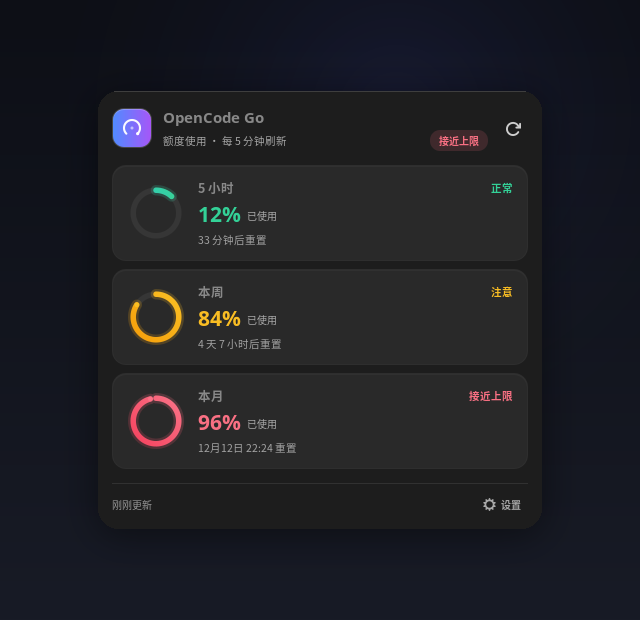
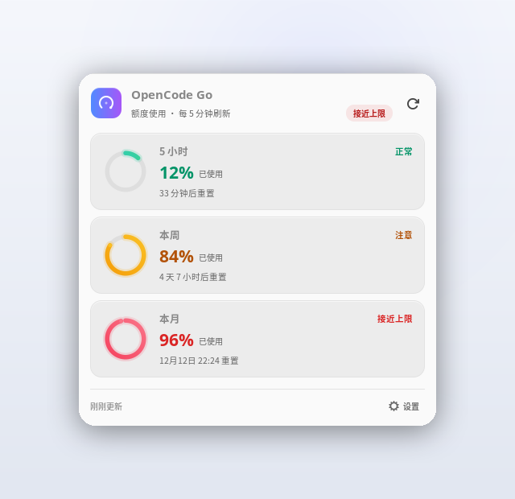
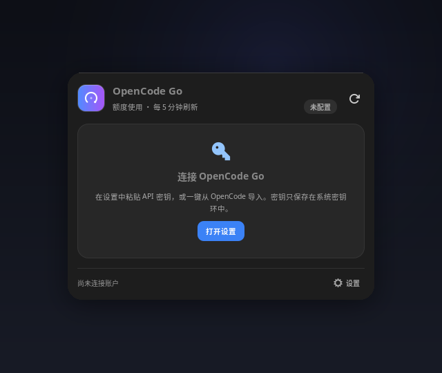

# OpenCode Go Usage v2

**GNOME 顶栏的 OpenCode Go 额度指示器**

[](https://github.com/YuchebHu/opencode-go-usage-v2/actions/workflows/ci.yml)
[](https://www.gnome.org/)
[](https://github.com/YuchebHu/opencode-go-usage-v2/releases/latest)
[](https://github.com/YuchebHu/opencode-go-usage-v2/blob/main/LICENSE)
[](https://github.com/YuchebHu/opencode-go-usage-v2)

一个为 Ubuntu / GNOME 打造的 OpenCode Go 额度指示器。它常驻在顶部状态栏，点击后展开一个现代化仪表盘，展示 OpenCode Go 的三个用量窗口：

- **5 小时** — 滚动窗口
- **本周** — 每周一 00:00 UTC 重置
- **本月** — 当前订阅周期

数据来自 OpenCode 官方的 `GET https://opencode.ai/inference/go/v1/usage` 接口，使用你已有的 Go API 密钥。

> 这是一个独立的社区工具，与 OpenCode / Anomaly 官方无关。  
> GitHub 仓库：[YuchebHu/opencode-go-usage-v2](https://github.com/YuchebHu/opencode-go-usage-v2)

<p align="center">
  
  
</p>
<p align="center"><sub>预览使用模拟额度数据，实际界面会跟随系统主题。</sub></p>

**2.1 新增**：自动导入 OpenCode 密钥、`opencode-go-usage-v2` 命令行工具、API 端点覆盖，以及深色/浅色预览。

## 为什么是 GNOME Shell 扩展

Ubuntu 默认使用 GNOME。相比托盘图标方案，GNOME Shell 扩展可以直接嵌入顶栏、跟随系统主题、在弹窗中使用 St/Cairo 绘制自定义仪表盘，而且不需要额外运行一个常驻的后台进程。

- 顶栏常驻：迷你环形仪表 + 百分比
- 点击展开：三张额度卡片、重置倒计时、状态、错误提示
- 系统集成：GNOME 密钥环保存密钥、GSettings 保存偏好、系统通知提醒
- 无运行时第三方依赖（GNOME Shell 已自带 GJS、libsoup、libsecret）

## 功能

- **顶栏实时指示**
  - 自动显示最紧张的额度窗口，也可以固定为本月 / 本周 / 5 小时
  - 环形仪表颜色随状态变化：正常 → 注意（70%）→ 接近上限（90%）→ 已限流
  - 可选隐藏百分比，只保留环形仪表
- **额度仪表盘**
  - 三个窗口的百分比、状态、重置倒计时
  - 环形进度入场动画，支持「减少动画」系统设置
  - 深色 / 浅色 GNOME Shell 主题自适应
- **自动刷新**
  - 默认每 5 分钟刷新，可配置 1–60 分钟
  - 打开弹窗时如果数据超过 1 分钟会立即刷新
  - 断网时保留上次数据并显示错误提示
  - 本地缓存不含任何密钥
- **密钥管理**
  - 首次启动且密钥环为空时，可自动从 `opencode auth export` 读取当前启用的 Go 密钥；可在设置中关闭
  - 也可以一键手动导入，或粘贴 Console 的 API 密钥
  - 密钥存储在 GNOME 密钥环，不写入 GSettings 或缓存
  - 保存后立即通知扩展刷新，无需重启
- **额度提醒**
  - 达到可配置阈值（默认 80%）时发送桌面通知
  - 任一窗口被限流时通知
  - 同一个重置周期内不会重复打扰
- **稳健的错误处理**
  - 401 密钥无效、403 无有效订阅、429 请求过频、网络错误分别提示
  - 错误状态下的「重试」与「打开设置」入口
  - 密钥环不可用时给出明确说明
- **命令行工具**
  - 安装后提供 `opencode-go-usage-v2`
  - 支持人类可读的进度条、`--json`、`--endpoint` 覆盖
  - 密钥查找顺序：环境变量 → GNOME 密钥环 → OpenCode CLI
- **高级配置**
  - 可在设置中覆盖 usage 端点，方便使用兼容代理
  - 修改端点时会自动清空缓存并重新获取

## 环境要求

- Ubuntu 24.04+（GNOME Shell 45–48，开发与测试环境为 GNOME Shell 46 / Wayland）
- 一个有效的 OpenCode Go / Go Plus / Go Teams 订阅及 API 密钥
- GNOME Keyring（Ubuntu 默认已安装）
- 自动/手动从 OpenCode 导入密钥时，需要 `opencode` CLI 在 `PATH` 中（也会检查 `~/.opencode/bin/opencode`）

Node.js 只用于开发和运行测试，运行扩展本身不需要 Node。

## 安装

### 从源码安装

```bash
git clone https://github.com/YuchebHu/opencode-go-usage-v2.git
cd opencode-go-usage-v2
make install
```

Wayland 下新安装的扩展需要重新登录后才会被 GNOME Shell 加载。安装脚本不会修改扩展列表；如果重新登录后顶栏仍未出现图标：

```bash
make enable
```

也可以使用 GNOME 的「扩展」应用启用 **OpenCode Go 额度**。

### 从 GitHub Release 安装

不想安装编译依赖时，可以直接下载最新发布包：

1. 打开 [Releases](https://github.com/YuchebHu/opencode-go-usage-v2/releases/latest)
2. 下载 `opencode-go-usage-v2@local.shell-extension.zip`
3. 安装并重新登录：

```bash
gnome-extensions install --force opencode-go-usage-v2@local.shell-extension.zip
# 注销并重新登录后
gnome-extensions enable opencode-go-usage-v2@local
```

Release 安装不会创建 `~/.local/bin` 命令行包装器；需要 CLI 时请使用源码安装。

启用后，顶栏右侧会出现一个环形仪表。

如果密钥环为空且「自动导入 OpenCode 密钥」开启（默认），扩展会在首次启动时自动读取 OpenCode 当前启用的 Go 密钥并保存到密钥环，通常不需要任何配置。

如果没有自动导入，点击顶栏指示器 →「打开设置」：

<p align="center">
  
</p>

1. 点击 **从 OpenCode 导入**，或手动粘贴 API 密钥
2. 点击 **测试** 验证连接
3. 点击 **保存**

保存后仪表盘会自动开始刷新。安装脚本同时会在 `~/.local/bin/opencode-go-usage-v2` 安装命令行工具。

### 本地打包安装

```bash
make pack
gnome-extensions install --force dist/opencode-go-usage-v2@local.shell-extension.zip
# 重新登录后
gnome-extensions enable opencode-go-usage-v2@local
```

手动 zip 安装不会创建 `~/.local/bin` 包装器；如需命令行工具，可运行安装目录中的 `scripts/usage-cli.js`，或使用 `make install`。

## 使用

- 点击顶栏指示器打开仪表盘。
- 右上角刷新按钮会立即请求最新额度。
- 弹窗底部「设置」可打开偏好设置。
- 顶栏百分比在「自动」模式下代表三个窗口中占用比例最高的一个。
- 提示：Go 的三个窗口共享同一份额度；5 小时窗口是月额度的 20%，周窗口是 50%。

### 设置项

| 设置 | 说明 |
| --- | --- |
| 顶栏显示 | 自动（最紧张的额度）/ 本月 / 本周 / 5 小时 |
| 显示百分比 | 关闭后顶栏只显示环形仪表 |
| 自动刷新 | 1–60 分钟，默认 5 分钟 |
| 自动导入 OpenCode 密钥 | 密钥环为空时，启动时自动读取 `opencode auth export` |
| 额度提醒 | 是否发送桌面通知 |
| 提醒阈值 | 50%–100%，默认 80% |
| 限流提醒 | 任一窗口用尽时是否通知 |
| API 端点 | 高级选项，默认官方端点；修改后自动清缓存并刷新 |

## 安全与隐私

- API 密钥保存在 **Secret Service / GNOME Keyring**，属性为 `provider=opencode-go`。
- 密钥不会出现在日志、GSettings 或缓存中。自动导入只把密钥写入密钥环，命令行工具只读取、不保存。
- 默认唯一的网络请求是 `GET https://opencode.ai/inference/go/v1/usage`；如果手动配置了 API 端点，则请求该端点。
- 本地缓存位置：`~/.cache/opencode-go-usage-v2/usage.json`，只包含端点、百分比、状态、重置时间和通知去重状态，不含密钥。
- 没有遥测、没有统计上报、没有第三方脚本。

如果不再使用，建议先在偏好设置中点击「删除」清除密钥，再卸载扩展。

## 开发

```bash
make check          # gschema 编译 + Node 语法检查
make test           # 35 个纯 JS 单元测试（用量解析、格式化、通知去重、端点校验、密钥导入）
make install        # 安装扩展 + CLI 到 ~/.local/bin/opencode-go-usage-v2
make reload         # 尝试重新加载扩展（首次安装仍需重新登录）
make pack           # 生成 dist/*.shell-extension.zip
```

### 命令行工具

`make install` 后会提供 `opencode-go-usage-v2`：

```bash
# 人类可读输出
opencode-go-usage-v2

# JSON 输出
opencode-go-usage-v2 --json

# 使用兼容代理端点
opencode-go-usage-v2 --endpoint https://example.com/inference/go/v1/usage

# 查看帮助
opencode-go-usage-v2 --help
```

密钥查找顺序是 `OPENCODE_GO_API_KEY` → GNOME Keyring → `opencode auth export`，不会打印密钥。源码目录中也可以直接运行：

```bash
gjs -m scripts/usage-cli.js
```

### 目录结构

```text
opencode-go-usage-v2/
├── extension.js              # 生命周期、轮询、通知、缓存
├── prefs.js                  # GTK4 / libadwaita 偏好设置
├── metadata.json
├── stylesheet.css            # GNOME Shell 样式（深/浅色）
├── schemas/                  # GSettings
├── src/
│   ├── api.js                # libsoup 客户端与错误映射
│   ├── cache.js              # 本地缓存（无密钥）
│   ├── constants.js          # 模型、颜色、阈值、端点
│   ├── errors.js
│   ├── endpoint.js           # 端点校验与回退
│   ├── format.js             # 百分比、倒计时、相对时间
│   ├── import.js             # opencode auth export 解析
│   ├── keyring.js            # libsecret
│   ├── notifications.js      # 通知去重
│   ├── opencode.js           # 调用 opencode CLI 读取凭据
│   ├── usage.js              # 响应解析与状态计算
│   ├── ui/
│   │   ├── indicator.js      # 顶栏按钮
│   │   └── menuContent.js    # 弹出仪表盘
│   └── widgets/
│       ├── brandMark.js
│       ├── meterCard.js
│       ├── panelGauge.js
│       └── quotaRing.js      # Cairo 环形仪表
├── scripts/usage-cli.js     # 安装为 opencode-go-usage-v2
├── docs/                    # 深色 / 浅色 / 首次配置预览
└── tests/
```

### 设计说明

- 环形仪表使用 `St.DrawingArea` + Cairo 绘制，支持 HiDPI、圆角线帽、渐变和柔光。
- 顶栏与弹窗的尺寸、颜色、间距全部由扩展 CSS 控制；`ocgo-light` 类根据 `St.Settings.color-scheme` 切换浅色配色。
- 百分比颜色阈值固定为 70% / 90%，与可配置的通知阈值解耦，避免改通知设置时仪表盘颜色突变。
- 打开弹窗的自动刷新有 1 秒节流；后台轮询与手动刷新共用同一个请求锁，避免并发请求。
- 错误不会清空最近一次成功数据，便于离线时继续查看。
- 自动导入只在密钥环为空且开关开启时执行一次；导入结果写入密钥环，不会在每个刷新周期调用 CLI。

## 排错

**顶栏没有出现图标**

```bash
gnome-extensions info opencode-go-usage-v2@local
gnome-extensions enable opencode-go-usage-v2@local
```

Wayland 下安装新扩展后必须重新登录。查看 Shell 日志：

```bash
journalctl --user -f -o cat /usr/bin/gnome-shell
```

**提示 API 密钥无效（HTTP 401）**

在设置中更新密钥，点击「测试」确认。密钥必须属于有效的 Go 订阅。

**提示没有 Go 订阅（HTTP 403）**

确认 OpenCode Console 中的 Go 订阅仍然有效；Go Teams 需要使用任意成员的个人密钥。

**自动导入 / 「从 OpenCode 导入」失败**

确认 `opencode auth export` 可正常运行，并且至少有一个启用的 OpenCode Go 凭据：

```bash
opencode auth list
opencode auth export >/dev/null && echo ok
```

如果 `opencode` 不在 `PATH` 中，可以在设置里手动粘贴密钥，或设置 `OPENCODE_BIN` 后重启扩展。

**自定义端点无法连接**

端点必须是完整的 `http://` 或 `https://` URL。修改后扩展会清空本地缓存并立即重新请求；恢复默认端点可在设置的「高级」分组中操作。

**提示无法访问系统密钥环**

确认 GNOME Keyring 已解锁。在 Ubuntu 上通常是登录时自动解锁；如果使用无密码登录或自定义 PAM，需要先解锁默认密钥环。

**修改代码后没有生效**

```bash
make install
make reload
```

如果 `make reload` 报错，注销并重新登录。

## 卸载

```bash
make uninstall
rm -rf ~/.cache/opencode-go-usage-v2
```

`make uninstall` 同时会删除 `~/.local/bin/opencode-go-usage-v2`。

如果不再使用，请先在偏好设置中删除密钥。

## 许可

MIT。详见 [LICENSE](LICENSE)。
